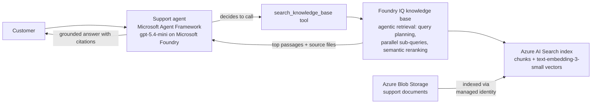

# Contoso Home Services — AI Customer Support Agent on Azure

An agentic AI customer-support agent for **Contoso Home Services**, a fictional home automation
managed service provider (smart home hub, sensors, cameras, locks, 24/7 alarm monitoring).
The agent answers customer questions **grounded in the company's support documentation**,
cites its sources, refuses to guess, routes emergencies to 911 first, and hands off to a human
when it can't help.

Built pro-code on **Microsoft Foundry** with **Microsoft Agent Framework**, grounded with a
**Foundry IQ** knowledge base on **Azure AI Search** — keyless end to end (Microsoft Entra ID
and managed identities, no API keys in code or configuration).

> **Status:** Milestone 1 of 5 complete (grounded agent). Tools, evaluation, tracing,
> infrastructure as code and a demo video are next — see the [roadmap](#roadmap) and
> [progress log](docs/progress.md).

## How it works



1. The agent receives a question and **decides on its own** whether to search the knowledge base.
2. The knowledge base plans sub-queries with an LLM, runs them in parallel (hybrid keyword + vector),
   and reranks the results semantically.
3. The agent writes the answer **only from the returned passages** and ends with `Sources: …`.

## What it does

| Capability | Example |
|---|---|
| Grounded, multi-document answers with citations | "Does alarm monitoring keep working if my internet goes down?" → plan-dependent answer from the plans and monitoring docs |
| Multi-turn context | "I'm on Essentials — what's the cheapest way to get that?" |
| Troubleshooting from documentation | "My hub light is blinking blue" → numbered steps |
| Doesn't guess | "Can you repair my furnace?" → says it doesn't know, offers a human |
| Hard limits | Won't cancel service, issue refunds, change the alarm passcode or unlock doors |
| Safety first | CO alarm, fire, break-in → "leave if unsafe and call 911" before anything else |
| Layered safety | Azure content filter blocks harmful requests; the app handles it gracefully and keeps the conversation going |
| Multilingual | Answers in the customer's language from English documents |

## Design decisions

Each decision is recorded as an Architecture Decision Record:

- [ADR 0001](docs/decisions/0001-dev-environment.md) — GitHub Codespaces with a pinned dev container
- [ADR 0002](docs/decisions/0002-agent-stack.md) — Microsoft Agent Framework (code-first) on Microsoft Foundry, grounded with Foundry IQ
- [ADR 0003](docs/decisions/0003-use-case-home-automation.md) — Home automation support use case

Highlights:
- **Code-first agent** (not a portal-defined agent) so the agent is versioned, reviewable and testable in CI.
- **Extractive retrieval:** the knowledge base returns passages and the agent writes the answer, so safety
  rules, tone and escalation live in one place.
- **Keyless:** the app uses Entra ID; Azure AI Search reads Blob Storage and calls the models with its own
  managed identity, with least-privilege roles.
- **Measured, not assumed:** retrieval quality is checked with reranker scores; the relevance threshold will
  be tuned against an evaluation set rather than by feel.

## Repository layout

```
.devcontainer/                 Reproducible dev environment (Codespaces)
data/kb/                       Synthetic knowledge base (8 support documents)
docs/decisions/                Architecture Decision Records
docs/progress.md               Milestone progress log
scripts/setup_knowledge_base.py  Creates the Foundry IQ knowledge source + knowledge base, tests retrieval
src/knowledge_base.py          Retrieval client for the knowledge base
src/support_agent.py           The support agent (interactive or single question)
src/hello_agent.py             First ungrounded agent (baseline for comparison)
```

## Run it

> Infrastructure as code (Bicep + `azd up`) is planned for Milestone 4. Until then, resources are
> created with the Azure CLI.

**Prerequisites:** an Azure subscription, and the repo opened in GitHub Codespaces (the dev container
installs Python 3.12, Azure CLI, Bicep, azd and GitHub CLI).

1. **Azure resources:**
   - A Microsoft Foundry resource and project, with deployments of `gpt-5.4-mini` and
     `text-embedding-3-small`
   - An Azure AI Search service with agentic retrieval and semantic ranker enabled (the Free tier works),
     with a system-assigned managed identity
   - A Storage account with a `kb-docs` container holding the files from `data/kb/` (except `README.md`)
2. **Roles:**
   - You: *Search Service Contributor* and *Search Index Data Contributor* on Search;
     *Storage Blob Data Contributor* on Storage; *Foundry User* on the Foundry project
   - The Search service's managed identity: *Storage Blob Data Reader* on Storage;
     *Cognitive Services User* and *Cognitive Services OpenAI User* on the Foundry resource
3. **Configure and run:**
   ```bash
   az login
   python -m venv .venv && source .venv/bin/activate
   pip install -r requirements.txt
   cp .env.example .env        # then fill in your values
   python scripts/setup_knowledge_base.py
   python src/support_agent.py
   ```

## Roadmap

| # | Milestone | Status |
|---|---|---|
| 0 | Define & set up | ✅ |
| 1 | Grounded agent with citations and safety rules | ✅ |
| 2 | Tools: hub/device status lookup, callback booking, human hand-off with summary | Next |
| 3 | Evaluation (groundedness, relevance, safety test set) and tracing in Application Insights | |
| 4 | Hardening: prompt-injection tests, conversation data retention, Bicep + `azd up`, hosted agent | |
| 5 | Publish: demo video, architecture write-up | |

Stretch ideas: voice channel, multi-agent triage, MCP server for the tools, evals in CI.

## About this project

Built by **Avi Perpinyal** as a hands-on portfolio project in agentic AI on Azure. I use coding
agents (Claude Code) as part of my workflow: I make the architecture decisions and direct, review,
test and debug the code.

**All company names, prices, policies and documents are fictional demo data.**
`contoso-home.example` uses the reserved `.example` domain.

## License

[MIT](LICENSE)
